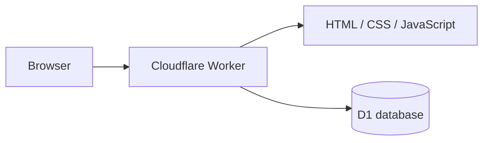

# Aawan Jaawan

**A little closer to home.** A community travel board connecting people in Hyderabad with familiar faces travelling to and from home.

**Live website: [aawanjaawan.fun](https://aawanjaawan.fun)**

Born from the Lucknow–Hyderabad community, Aawan Jaawan turns “Is anyone coming this week?” into a clear, shared board. Find a traveller, share your itinerary, or ask for a small favour without losing the details in a group chat.

## What you can do

- **Find a traveller:** post a request in either direction, choose a needed-by date and preferred transport, and explain what help you need.
- **Share your trip:** publish your travel date and transport, with optional itinerary details. Offering to carry a parcel is optional.
- **Browse the board:** filter by direction or date, search, and switch between trips and requests.
- **Keep useful posts:** save them in your browser for later.
- **Connect on WhatsApp:** contact a member using the number they provided.

Requests and trips have distinct fields and defaults. Notes are optional, dates must be today or later, and Indian ten-digit contact numbers are normalized to `+91`.

## Supported routes

The code supports travel in **both directions** between Hyderabad and:

- Lucknow
- Aligarh
- Delhi
- Allahabad
- Gorakhpur

The board keeps Lucknow–Hyderabad journeys easy to find while allowing the wider community to share trips on the other routes.

## How it works



The frontend uses plain HTML, CSS, and JavaScript. A Cloudflare Worker serves the assets and validates API requests. D1 stores community posts. The domain is registered at Hostinger; Cloudflare manages its DNS and HTTPS.

The deployed app needs no Google Sheets, Apps Script, Python server, or computer left running at home. The older integrations are retained as optional alternatives.

## Develop locally

Requirements: **Node.js 22+**, **npm**, and **Python 3.9+**. Python is used for asset generation and regression checks; it is not the production backend.

From the repository root:

```sh
npm ci
npm ci --prefix cloudflare
npm run dev
```

Open the local URL printed by Wrangler. This applies migrations to a **local D1 database** and starts the Worker with the same frontend and API used in production. Local test posts are separate from live community data. Use the Wrangler URL for posting tests because IntelliJ’s built-in preview and other static file servers do not serve the posts API.

For an asset-only demo, run `npm run build` and open `dist/index.html` directly as a file. That mode uses fictional example posts and browser-local storage. HTTP(S) visits always use the shared API and do not silently fall back to demo storage when saving fails.

## Verify changes

```sh
npm test
npm run format:check
```

`npm test` rebuilds the assets, runs the native Node frontend/Worker tests, and runs Python regression tests. Coverage includes both posting flows, field validation, filters, saved posts, WhatsApp links, failed submissions, duplicate clicks, stale refreshes, SQL migrations, and deployment database selection.

The frontend tests use a simulated DOM; the Worker tests use native Web APIs and a simulated D1 binding. Python executes the actual schema in temporary SQLite. Additional JavaScriptCore tests run on macOS. Automated checks do not write to the live database and do not replace real-browser testing.

To validate the Cloudflare bundle without publishing:

```sh
cd cloudflare
npx wrangler deploy --dry-run
```

## Release workflow

Develop on `dev`. Run the local checks, push changes to `origin/dev`, and publish the staging Worker from that branch:

```sh
npm test
npm run format:check
npm run deploy:staging
```

Smoke-test [aawanjaawan-dev.aawanjaawan.workers.dev](https://aawanjaawan-dev.aawanjaawan.workers.dev) using fictional test records. Staging has its own D1 database. When a change is ready, merge `dev` into `main` through a pull request. On the updated `main` checkout, run `npm run deploy` and verify [aawanjaawan.fun](https://aawanjaawan.fun). Git pushes run checks. Deployments are manual.

## Deploy to production

The current Cloudflare project is configured in `cloudflare/wrangler.jsonc`. Database IDs identify resources; they are not credentials. Authentication stays in your local Wrangler login or your deployment environment.

```sh
cd cloudflare
npm run login
npm run whoami
npm run deploy
```

Deploy builds the assets, performs a dry run, applies remote D1 migrations, and publishes the Worker. Confirm the account and database before running it. For a new account, database setup, or domain configuration, see the [deployment guide](cloudflare/README.md). Do not reuse the existing database UUID in an unrelated account.

After publishing:

1. Open [the website](https://aawanjaawan.fun) on desktop and phone.
2. Check [`/api/health`](https://aawanjaawan.fun/api/health), which should return `{"ok":true,"storage":"d1"}`.
3. Post a test request or trip and confirm it appears in another browser.
4. Confirm the WhatsApp link and `www` → apex redirect.

## API and data

| Endpoint          | Purpose                                    |
| ----------------- | ------------------------------------------ |
| `GET /api/health` | Check the database binding and posts table |
| `GET /api/posts`  | List active, unexpired posts, newest first |
| `POST /api/posts` | Validate and create a trip or request      |

A post contains `id`, `name`, `phone`, `route`, `date`, `mode`, `help`, `note`, `type`, `created`, and `status`. The server assigns its ID, creation time, and active status. `lko` means Lucknow → Hyderabad; `hyd` means Hyderabad → Lucknow. Additional routes use city-pair keys such as `delhi-hyd` and `hyd-delhi`. Dates use `YYYY-MM-DD`; expiry follows India time.

Administrators can manage records in **Cloudflare → D1 → aawanjaawan → Console**. Marking a row `completed` or `cancelled` hides it from the board. Past trips/requests are hidden automatically; their records remain in the database. Keep database exports/backups outside this repository.

**Privacy and current limits:** this is a public community board. People with access can read active posts and WhatsApp numbers and submit posts. There is no member login, owner edit/delete UI, automated matching, or spam protection yet. Saved posts are personal to each browser. A request requires a deadline; open-ended dates and date ranges are not supported. After an ambiguous save timeout, check the board before retrying because a remote write may have completed.

## Project map

| Path                          | Contents                                                   |
| ----------------------------- | ---------------------------------------------------------- |
| `src/`                        | Frontend source and public assets                          |
| `cloudflare/worker.mjs`       | Production API, validation, and asset handler              |
| `cloudflare/migrations/`      | Versioned D1 schema                                        |
| `cloudflare/launch.py`        | First-time provision/reuse and deployment helper           |
| `build.py`                    | Reproducible static/legacy HTML generation                 |
| `test/`                       | Node and Python regression suites                          |
| `docs/REGRESSION-REVIEW.md`   | Detailed requirements review and manual QA checklist       |
| `integrations/google-sheets/` | Legacy Apps Script backend and setup guide                 |
| `server.py`                   | Legacy Python Sheets proxy / optional SQLite server        |
| `memory.md`                   | Project decisions, deployment history, and session handoff |

Generated assets, IDE files, credentials, logs, and local databases are ignored by Git. `dist/`, `cloudflare/public/`, and the generated legacy `Index.html` are rebuilt with `npm run build`.

## Legacy storage options

For the optional Python SQLite server:

```sh
npm run build
AAWAN_SHEETS_URL="" python3 server.py
```

For Google Sheets, follow the [legacy setup guide](integrations/google-sheets/SETUP.md). Set `AAWAN_SHEETS_URL` to your own deployed Apps Script `/exec` URL or create an ignored root `config.json` with a `sheets_url` property. Records are not automatically synchronized or migrated between these backends and D1.

## Git and website releases

GitHub stores the source and runs the checks in `.github/workflows/test.yml`, including a dry run for both Worker configurations.

For first-time repository setup, `scripts/publish.py` can prepare commits and reconcile an initial remote commit. With IntelliJ-managed GitHub authentication, use **Git → Fetch**, run `python3 scripts/publish.py --prepare-only`, then finish with **Git → Push**. Code conflicts stop for review; the helper never force-pushes.

This root `README.md` is the project's main documentation and the README GitHub should display.

## License

[MIT](LICENSE.txt). The original HTML5 Boilerplate license notice is retained.
